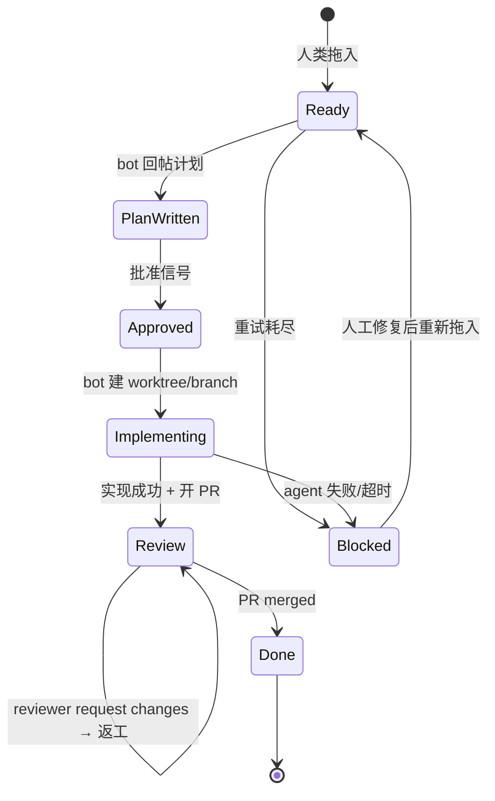

# firstsun-bot — 需求书

> 状态：草案 v1 · 最后更新 2026-07-22 · 上游来源：[issue #1](https://github.com/firstsun-dev/firstsun-bot/issues/1)、[`CLAUDE.md`](../CLAUDE.md)
>
> 本文定义**要做什么**与**做到什么程度算对**。技术方案见 [`SPEC.md`](./SPEC.md)，验证方式见 [`TEST-PLAN.md`](./TEST-PLAN.md)。

---

## 1. 产品目标与非目标

### 1.1 目标

把研发流程从「人写 issue → 人写代码 → 人开 PR」压缩为「人写 issue → 人批准计划 → 人 review PR」。

bot 承担三件事：
1. 把 issue 里的需求翻译成一份可审阅的设计/实施计划
2. 在人类批准计划后，实际改代码、跑测试、开 PR
3. 随 review 与 merge 把看板状态维持正确

### 1.2 非目标（首版明确不做）

| 不做 | 原因 |
|------|------|
| 自动 merge PR | 人类必须是最终闸门 |
| 无人值守全自动（跳过计划批准） | 批准环节是本产品的核心安全阀 |
| 多目标仓库并发处理 | 首版单仓库串行，并发引入 worktree 与配额竞争 |
| 非 Node 目标仓库的测试执行 | 测试命令的发现机制未定，见 §8 OQ-01 |
| **可交互**的 Web UI（手动重试、取消任务等写操作）| 需要鉴权与写操作路径，明显拉长首版。只读状态页见 §4.6 |
| 通知渠道（Slack / 邮件等） | issue 评论即通知 |

### 1.3 成功判据

首版垂直切片（Ready → Plan Written）交付时，以下必须为真：
- 在 sandbox 仓库把一个 issue 拖到 Ready，60 秒内 issue 上出现一条 bot 写的计划评论，且看板状态变为 Plan Written
- 在计划回帖后、看板更新前杀掉进程并重启，不会产生第二条计划评论
- 把 `TrackerProvider` 换成 fake 实现，orchestrator 代码零改动即可在测试中跑通全流程

---

## 2. 角色

| 角色 | 说明 |
|------|------|
| **Issue 作者** | 写需求，把 issue 拖到 Ready |
| **计划批准人** | 审阅 bot 写的计划并批准。必须具备目标仓库 write 权限（FR-11） |
| **PR Reviewer** | 审阅 PR，approve 或 request changes |
| **Bot 身份** | 以 machine account PAT 或 GitHub App 身份操作。所有 bot 产出的评论必须可被识别为 bot 所写 |

首版允许上述前三个角色为同一自然人。

---

## 3. 生命周期与状态定义

### 3.1 状态机

### 3.2 各状态契约

| 状态 | 进入条件 | Bot 行为 | 正常退出条件 | 异常退出 |
|------|---------|---------|-------------|---------|
| **Ready** | 人类把 issue 置为 Ready | 读 issue body + 已有评论 → 调 AgentProvider(`mode: 'plan'`) 生成计划 → 回帖 → 置为 Plan Written | 计划评论已存在 | agent 失败超重试上限 → Blocked |
| **Plan Written** | bot 回帖成功 | 每 tick 检查批准信号 | 检测到有效批准信号 → Approved | 人类改回 Ready → 重新生成计划 |
| **Approved** | 批准信号被确认 | 建 worktree + branch | worktree 就绪 → Implementing | git 操作失败 → Blocked |
| **Implementing** | worktree 就绪 | 调 AgentProvider(`mode: 'implement'`) → 跑目标仓库测试 | agent 成功且测试通过 → 开 PR → Review | 失败/超时 → 清理 worktree → Blocked |
| **Review** | PR 已开且关联 `Closes #N` | 轮询 PR review 状态 | PR merged → Done | reviewer request changes → 留在 Review 并触发返工 |
| **Review（返工）** | reviewer 提交 change request | 读 review 评论 → 同分支重调 agent → 跑测试 → push | 新 commit 已 push，回到等待 review | 返工失败超上限 → Blocked |
| **Done** | PR merged | 回写看板 Done。issue 关闭依赖 `Closes #N` 原生行为，bot 不重复关闭 | — | — |
| **Blocked** | 任一步失败超重试上限 | 回帖错误摘要（脱敏）→ 置为 Blocked | 人工介入 | — |

> **状态命名说明**：本文的状态名与 issue #1、`CLAUDE.md` 保持一致（**Plan Written**），对应 [`SPEC.md`](./SPEC.md) 的 `WorkflowStatus` 枚举值 `plan_written`。注意该状态在语义上是「计划已写好、等待人类审阅」的**等待态**。看板字段的实际取值（列名）与此枚举通过配置映射，两者不是同一层概念（见 SPEC §8）。

---

## 4. 功能性需求

> 每条需求可独立测试，编号被 [`TEST-PLAN.md`](./TEST-PLAN.md) 引用。

### 4.1 轮询与触发

| ID | 需求 | 优先级 |
|----|------|--------|
| **FR-01** | bot 以常驻服务方式运行，按可配置间隔（默认 60s）轮询 tracker，获取处于各工作流状态的 issue 列表 | 首版 |
| **FR-02** | 工作流状态的唯一真相源是 tracker（看板状态字段 + issue 评论）。bot 不得依赖内存或本地文件中的状态来决定下一步动作 | 首版 |
| **FR-03** | 所有状态转换必须幂等。进程在「已产生外部副作用、尚未更新看板状态」的窗口中崩溃并重启后，重跑同一转换不得产生重复副作用（重复评论、重复 PR、重复分支） | 首版 |
| **FR-04** | bot 在单次 tick 内至多处理一个 issue 的一次状态转换，避免长时任务阻塞轮询 | 首版 |

### 4.2 计划生成（Ready → Plan Written）

| ID | 需求 | 优先级 |
|----|------|--------|
| **FR-05** | bot 读取 issue 标题、正文与全部已有评论，作为计划生成的输入上下文 | 首版 |
| **FR-06** | bot 通过 `AgentProvider` 生成计划，不得直接调用任何具体 agent CLI | 首版 |
| **FR-07** | 计划以 issue 评论形式回帖，正文中含机器可识别的 marker（HTML 注释，渲染后不可见），供 FR-03 幂等去重 | 首版 |
| **FR-08** | 计划回帖成功后，bot 将看板状态更新为 Plan Written | 首版 |
| **FR-09** | 若 agent 返回失败，bot 按 NFR-05 重试；重试耗尽后回帖脱敏的错误摘要并置为 Blocked | 首版 |

### 4.3 批准

| ID | 需求 | 优先级 |
|----|------|--------|
| **FR-10** | 批准信号的判定方式可配置，支持三种模式：看板状态变更、issue 评论关键字、label。配置面首版必须完整存在 | 首版（配置面）|
| **FR-11** | 只有对目标仓库具备 write 权限的人给出的批准才生效。无权限者的批准信号必须被忽略且不改变状态 | 首版 |
| **FR-12** | 批准信号的产生时间必须晚于最新一版计划评论的时间。对旧版计划的批准不生效 | 首版 |
| **FR-13** | 若人类把 issue 从 Plan Written 改回 Ready，bot 视为要求重新生成计划，并作废此前的计划 marker | 首版 |

### 4.4 实现与 PR（feat-008~010，接口须预留）

| ID | 需求 | 优先级 |
|----|------|--------|
| **FR-14** | bot 为每个 issue 建立独立 git worktree 与分支，分支名可由 issue 编号确定性推导（幂等前提）| 后续 |
| **FR-15** | agent 实现完成后，bot 在 worktree 内执行目标仓库的测试命令；测试不通过不得开 PR | 后续 |
| **FR-16** | PR 正文必须包含 `Closes #N` 以启用原生 issue 自动关闭 | 后续 |
| **FR-17** | reviewer 提交 change request 后，bot 读取 review 评论并在同一分支上重新调用 agent，不新建分支或 PR | 后续 |
| **FR-18** | PR merged 后 bot 只负责把看板状态置为 Done，不重复关闭 issue | 后续 |

### 4.5 可观测性

| ID | 需求 | 优先级 |
|----|------|--------|
| **FR-19** | 每次状态转换须产生结构化日志，含 issue 标识、源状态、目标状态、耗时、结果 | 首版 |
| **FR-20** | 失败时回帖到 issue 的错误摘要须对人类可操作（说明哪一步失败、下一步该做什么），且不含任何凭证 | 首版 |

### 4.6 只读状态界面（feat-013）

> **动机**：issue 评论能回答「某个 issue 走到哪了」，但回答不了运维层面的问题——进程还活着吗？上次轮询是什么时候？现在有几个任务在飞？哪个失败了、重试到第几次？这些状态目前只存在于日志和 `state.json`，出问题时只能翻日志。对一个常驻轮询服务，这个盲区不可接受。

| ID | 需求 | 优先级 |
|----|------|--------|
| **FR-21** | bot 暴露 `GET /healthz`，返回进程存活与 uptime，供进程监控与重启策略使用 | 后续 |
| **FR-22** | bot 暴露 `GET /status`，以 JSON 返回运行时快照：上次/下次轮询时间、上次 tick 耗时、各工作流状态的 issue 计数、在飞任务列表、处于退避中的失败任务（含 `attempts`、`nextEligibleAt`、脱敏后的 `lastError`）| 后续 |
| **FR-23** | bot 暴露 `GET /`，返回一个自包含的单页 HTML，渲染 FR-22 的内容并定期自动刷新。不得依赖任何外部 CDN 资源 | 后续 |
| **FR-24** | 状态界面**只读**。不得提供任何改变 bot 或 tracker 状态的端点 | 后续 |
| **FR-25** | HTTP 服务默认只监听 `127.0.0.1`，监听地址与端口可配置；绑定到非回环地址时须在启动日志中给出显式告警 | 后续 |
| **FR-26** | 状态界面的所有输出必须经过与日志相同的脱敏处理，不得包含凭证、issue 正文全文或计划正文全文 | 后续 |
| **FR-27** | 状态数据只能来自 orchestrator 的内存视图与 `StateStore`，**不得**为渲染页面而直接调用 tracker API | 后续 |
| **FR-28** | HTTP 服务故障（端口占用等）不得影响轮询主循环；启动失败须记录错误并继续运行核心功能 | 后续 |

---

## 5. 非功能性需求

| ID | 需求 |
|----|------|
| **NFR-01** | 轮询间隔可配置，默认 60s。对 tracker API 的调用须遵守速率限制；收到 429/二级限流时指数退避而非崩溃 |
| **NFR-02** | 单次 agent 运行有可配置超时（默认 30 分钟）。超时须终止子进程树并清理该次运行创建的 worktree |
| **NFR-03** | 凭证仅从环境变量读取。禁止写入仓库、禁止出现在日志、禁止出现在 issue 评论。本仓库为公开仓库 |
| **NFR-04** | 进程可在任意时刻被杀死并重启，不依赖内存状态即可恢复（FR-02 + FR-03 的直接推论）|
| **NFR-05** | 可重试错误（网络、限流、5xx）按指数退避重试，次数可配置（默认 3）。不可重试错误（401/403/配置错误）立即失败并置 Blocked |
| **NFR-06** | 本地缓存目录可被安全删除。删除后 bot 须能仅凭 tracker 状态恢复运行，最坏情况是重建 worktree |
| **NFR-07** | 依赖 Node LTS，跨 Linux/macOS 可运行。不依赖容器编排 |
| **NFR-08** | 所有依赖在项目初始化时取当时的最新稳定版；若某依赖因 peer 冲突无法取最新，须在 [`SPEC.md`](./SPEC.md) §2.2 记录事实、决定与解除条件，并登记到 `progress.md` 的 Risks 段 |
| **NFR-09** | 包管理器版本由 `packageManager` 字段固定，锁文件入库；`./init.sh` 使用 `--frozen-lockfile`，不得在验证过程中静默改动锁文件 |
| **NFR-10** | 所有 commit message 遵循 Conventional Commits，由 commit-msg hook 强制；type 与 scope 取白名单（[`SPEC.md`](./SPEC.md) §2.3）|
| **NFR-11** | 提交前须自动执行暂存文件的 lint、格式检查与密钥正则扫描。此为反馈提速手段，**不替代**服务端 push protection（NFR-03）|

---

## 6. 架构约束

> 从 [`CLAUDE.md`](../CLAUDE.md) 抬为正式需求。这是硬约束，不是建议。

| ID | 约束 | 强制手段 |
|----|------|---------|
| **AC-01** | `src/providers/tracker/github/` 之外的任何文件，禁止 import Octokit / GitHub SDK / 调用 `gh` | eslint `no-restricted-imports` 分区规则 + 禁止 `gh` 字符串的自定义规则 |
| **AC-02** | `src/providers/agent/claude-code/` 之外的任何文件，禁止 shell out `claude` 或 import Claude-Code 专属 SDK | 同上 |
| **AC-03** | `src/orchestrator/` 只允许依赖 `src/domain`、`src/providers/*/types.ts`、`src/config`、`src/state`、`src/util`，不得依赖任何 concrete provider 目录 | eslint 分区规则 |
| **AC-04** | `AgentProvider` 的 plan 与 implement 两种用途走同一接口，且配置上可分别绑定不同的 concrete provider | 契约测试（TEST-PLAN §4）|
| **AC-05** | 新增一个 tracker 或 agent 实现，不得需要修改 `src/orchestrator/` 中的任何文件 | 契约测试 + code review |
| **AC-06** | 状态界面（`src/http/`，feat-013）只依赖 orchestrator 暴露的只读快照接口与 `StateStore`，禁止 import 任何 concrete provider，禁止发起对外网络调用 | eslint 分区规则（第 4 个 zone）+ 架构测试 |

> **AC-01/02/03 的 lint 规则本身必须有测试**：故意在 orchestrator 中 import Octokit，断言 lint 报错。规则写错而无人察觉，等同于没有约束。

---

## 7. 术语表

| 术语 | 定义 |
|------|------|
| **Tracker** | 承载 issue 与看板的系统。今天是 GitHub Issues + Projects v2，未来可能是 GitLab Issues + Boards |
| **Agent** | 执行代码理解与修改的 AI 编码工具。今天是 Claude Code CLI，未来可能是 Codex CLI 等 |
| **Workflow Status** | bot 内部的规范化状态枚举（§3.1）。与 tracker 上看板字段的实际取值通过配置映射，两者不是同一概念 |
| **Approval Signal** | 表示人类批准计划的可观测事实。三种可配置形态见 FR-10 |
| **Worktree** | `git worktree` 创建的独立工作目录，一个 issue 一个，用于隔离 agent 的改动 |
| **目标仓库** | bot 要修改的那个仓库。可以是 firstsun-bot 自身，也可以是别的仓库 |
| **Marker** | 嵌在 bot 评论中的机器可识别标记（HTML 注释），用于幂等去重 |

---

## 8. 开放问题

> 未决即未决，不假装已解决。每项需在其阻塞的 feature 开工前收敛。

| ID | 问题 | 阻塞 | 倾向 |
|----|------|------|------|
| **OQ-01** | 目标仓库的测试命令如何获知？固定约定（如 `./init.sh`）/ 每仓库配置文件 / 让 agent 自行判断？注意目标仓库的包管理器未必与本仓库一致 | FR-15、feat-008 | 倾向配置文件，agent 自判不可验证 |
| **OQ-02** | 一个 issue 对应多个 PR（拆分实现）如何处理？ | feat-008 | 首版限定 1:1，多 PR 直接置 Blocked |
| **OQ-03** | agent 的 token 成本上限与熔断机制 | NFR-02 之外 | 首版仅做时间超时，成本熔断留待观察真实消耗 |
| **OQ-04** | bot 身份用 PAT 还是 GitHub App？App 的权限粒度更好但配置成本高 | feat-003 | 首版 PAT，接口不暴露差异 |
| **OQ-05** | 目标仓库与 bot 运行环境的关系：bot 是否有权限直接 push 到目标仓库？fork 流程是否需要支持？ | feat-008 | 首版假设有直接 push 权限 |
| **OQ-06** | Blocked 状态的人工恢复路径是否需要 bot 侧支持（如评论 `/retry`）？ | 后续 | 首版靠人类手动拖回 Ready |
