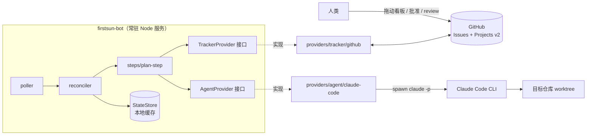

# firstsun-bot — 技术规格书

> 状态：草案 v1 · 最后更新 2026-07-22
>
> 本文定义**怎么做**。需求与验收标准见 [`REQUIREMENTS.md`](./REQUIREMENTS.md)，验证方式见 [`TEST-PLAN.md`](./TEST-PLAN.md)。
> 本文覆盖**首版垂直切片：Ready → Plan Written**（feat-001~007）。feat-008~010 所需的类型与接口方法在此一并定义，以保证后续无破坏性变更。

---

## 1. 系统上下文



关键点：`orchestrator` 只看到两个接口（实线）；具体实现（虚线）由 `src/composition/container.ts` 单点注入。

---

## 2. 技术选型

| 关注点 | 决定 | 一句话理由 |
|--------|------|-----------|
| 包管理器 | **pnpm**，经 corepack 固定版本（`packageManager` 字段）| 严格 node_modules 天然防止「幽灵依赖」——这与本项目按目录封闭 provider 的核心约束同向；且 lockfile 确定性更强 |
| 模块系统 | ESM（`"type": "module"`，相对导入带 `.js`）| 常驻服务，无需双构建 |
| Node | `>= 24.0.0`（`.nvmrc` = `24`）| 现行 Active LTS，本机 v24.18.0；且 pnpm 11 要求 ≥22.13、`lint-staged` ≥22.22.1、`@commitlint/cli` ≥22.12，取 24 一次到位 |
| 构建 | `tsc`（`tsconfig.build.json` → `dist/`）| 是服务不是库，打包无收益且会污染堆栈 |
| TS 配置 | `module/moduleResolution: nodenext`、`target: es2023`、`strict`、`noUncheckedIndexedAccess`、`verbatimModuleSyntax` | `verbatimModuleSyntax` 强制 `import type`，让边界 lint 规则无歧义 |
| 测试 | vitest | `progress.md` 已推荐；ESM + TS 零额外 transform |
| Lint | ESLint flat config + typescript-eslint | 唯一能表达本项目核心约束（按目录分区的 import 禁令）的 linter |
| 格式 | Prettier，`lint` 里只 `--check` 不改写 | 保证 `./init.sh` 确定性 |
| 校验 | zod | 配置与 agent JSON 输出共用一个依赖 |
| 日志 | pino + `redact` + 自建 `redactSecrets()` | 公开仓库，token 泄漏是首要风险 |
| GitHub 接入 | `@octokit/rest` + `@octokit/graphql`（不用 `gh` CLI）| Projects v2 状态字段必须走 GraphQL mutation；库能给出类型化错误与限流响应头 |
| Claude 接入 | `claude -p --output-format json` 子进程 | 唯一受支持的 headless 接口；严格限制在 `src/providers/agent/claude-code/` |
| Git hooks | husky + lint-staged + commitlint | 提交前拦截，而不是等 CI；Conventional Commits 强制（见 §2.3）|

### 2.1 版本锁定（2026-07-22 核对 npm registry）

工具链：

| 组件 | 版本 | 固定方式 |
|------|------|---------|
| Node | `>= 24.0.0` | `engines.node` + `.nvmrc` = `24` |
| pnpm | `11.15.1` | `packageManager: "pnpm@11.15.1"` + corepack；**本机现为 10.33.0，需 `corepack enable` 后由该字段自动切换** |

运行时依赖：

| 包 | 版本 | 说明 |
|----|------|------|
| `@octokit/rest` | `^22.0.1` | 最新 |
| `@octokit/graphql` | `^9.0.3` | 最新 |
| `zod` | `^4.4.3` | 最新（v4 线）|
| `pino` | `^10.3.1` | 最新 |
| `dotenv` | `^17.4.2` | 最新 |

开发依赖：

| 包 | 版本 | 说明 |
|----|------|------|
| `typescript` | `~6.0.3` | **不取最新 7.0.2**，理由见 §2.2 |
| `vitest` | `^4.1.10` | 最新 |
| `@vitest/coverage-v8` | `^4.1.10` | 必须与 vitest 同版本（vitest 的 peer 是精确匹配）|
| `eslint` | `^10.7.0` | 最新 |
| `@eslint/js` | `^10.0.1` | 最新 |
| `typescript-eslint` | `^8.65.0` | 最新；peer `eslint: ^8.57 \|\| ^9 \|\| ^10` ✅ |
| `prettier` | `^3.9.6` | 最新 |
| `@types/node` | `^26.1.1` | 最新；vitest 4 的 peer 接受 `>=24` ✅ |
| `tsx` | `^4.23.1` | 最新，仅 `pnpm run dev` 用 |
| `husky` | `^9.1.7` | 最新 |
| `lint-staged` | `^17.1.1` | 最新；engines `node >=22.22.1` |
| `@commitlint/cli` | `^21.2.1` | 最新；engines `node >=22.12.0` |
| `@commitlint/config-conventional` | `^21.2.0` | 最新 |

### 2.2 已知版本冲突：TypeScript 7 vs typescript-eslint

**事实**（`npm view` 实测，非推测）：

- `typescript` 最新稳定版为 **7.0.2**
- `typescript-eslint@8.65.0`（latest）与 `8.65.1-alpha.4`（canary）的 peer 均为 `typescript: >=4.8.4 <6.1.0`
- 因此**目前没有任何 typescript-eslint 版本支持 TS 7**
- 满足该区间的最高稳定版是 **`typescript@6.0.3`**

**决定：锁 `typescript@~6.0.3`。**

理由：本项目的核心架构约束（AC-01~03）完全依靠 ESLint 分区规则强制。如果为了追最新版而失去 typescript-eslint，等于把项目的硬约束降级为口头约定——这个代价远大于 TS 7 带来的收益。

**跟进条件**：typescript-eslint 发布支持 TS 7 的版本后，把 `typescript` 与 `typescript-eslint` 一起升级，并重跑 [`TEST-PLAN`](./TEST-PLAN.md) §5.1 的 lint 负例验证。此项记入 `progress.md` 的 Risks 段。

### 2.3 提交前门禁（husky + lint-staged + commitlint）

`./init.sh` 是完整验证闸门，但它是**人主动跑**的。提交前门禁负责让「忘了跑」不可能发生。

**`.husky/pre-commit`**

```sh
pnpm exec lint-staged
```

**`.lintstagedrc.json`**

```json
{
  "*.{ts,js,mjs}": ["eslint --max-warnings=0", "prettier --check"],
  "*.{json,md,yml,yaml}": ["prettier --check"]
}
```

只对暂存文件跑，秒级完成。**刻意不在 pre-commit 跑 `tsc` 与 vitest**——那会让提交慢到开发者去用 `--no-verify`，反而更糟。类型检查与测试留给 `./init.sh` 与 CI。

**`.husky/commit-msg`**

```sh
pnpm exec commitlint --edit "$1"
```

**`commitlint.config.js`** — 基于 `@commitlint/config-conventional`，并约束本仓库的 scope：

```js
export default {
  extends: ['@commitlint/config-conventional'],
  rules: {
    'type-enum': [2, 'always', [
      'feat', 'fix', 'docs', 'refactor', 'test',
      'chore', 'build', 'ci', 'perf', 'revert',
    ]],
    'scope-enum': [2, 'always', [
      'tracker', 'agent', 'orchestrator', 'config',
      'state', 'util', 'docs', 'harness', 'deps',
    ]],
    'scope-empty': [1, 'never'],   // 建议但不强制
    'subject-case': [2, 'never', ['upper-case', 'pascal-case', 'start-case']],
    'header-max-length': [2, 'always', 100],
    'body-max-line-length': [0],   // 关闭：commit body 里常有长 URL 与日志片段
  },
};
```

合法示例：`feat(tracker): add Projects v2 status field resolution`
非法示例：`update stuff`（无 type）、`feat(github): ...`（scope 不在白名单）

**`package.json`** 加 `"prepare": "husky"`，使 `pnpm install` 后 hooks 自动装好。

> **绕过策略**：`--no-verify` 允许在紧急情况使用，但 CI 与 `./init.sh` 仍会拦截，因此绕过只是延后而非免除。

### 2.3.1 `package.json` 脚本与 `init.sh`

```jsonc
{
  "packageManager": "pnpm@11.15.1",
  "engines": { "node": ">=24.0.0" },
  "type": "module",
  "scripts": {
    "lint": "eslint . --max-warnings=0 && prettier --check .",
    "format": "prettier --write .",
    "build": "tsc -p tsconfig.build.json",
    "test": "vitest run",
    "test:watch": "vitest",
    "dev": "tsx watch src/index.ts",
    "start": "node dist/index.js",
    "prepare": "husky"
  }
}
```

**`init.sh` 需要改**：现有版本调的是 `npm run lint/build/test`，改为 `pnpm run`，并在最前面加依赖安装：

```bash
corepack enable
pnpm install --frozen-lockfile
pnpm run lint
pnpm run build
pnpm test
```

`--frozen-lockfile` 保证 `init.sh` 不会静默改动 `pnpm-lock.yaml`——CLAUDE.md 要求「下一 session 能直接跑 `./init.sh`」，锁文件漂移会破坏这一点。

> `CLAUDE.md` 的「Verification Commands」段落也需同步改为 pnpm，否则文档与实际不一致。这是 feat-001 的收尾动作之一。

### 2.3.2 `.npmrc`

```
# 依赖必须显式声明才能 import —— 与 §9 的目录封闭约束同向
hoist=false
strict-peer-dependencies=true
# corepack 已固定版本，禁止意外的 pnpm 版本漂移
package-manager-strict=true
```

`hoist=false` 会让「某文件 import 了自己没声明的传递依赖」直接报错。这对本项目有额外价值：它使「orchestrator 意外拿到 Octokit」这类问题在**解析层**就失败，而不只依赖 lint 规则。

### 2.4 密钥扫描的位置

按 `CLAUDE.md` 的要求，公开仓库的密钥防护采用**双层**：

1. **服务端**：GitHub push protection + `ANTHROPIC_API_KEY` 自定义 secret 模式（按 vendored `secret-scanning` skill 配置）。这是权威闸门，本地绕不过
2. **本地**：`.husky/pre-commit` 中在 `lint-staged` 之前加一条对暂存内容的正则扫描（`ghp_` / `github_pat_` / `sk-ant-` / `gho_`），命中即拒绝提交

本地这层只是提速反馈，**不作为安全保证**——它可以被 `--no-verify` 绕过，服务端那层不行。

---

## 3. 领域类型

`src/domain/types.ts` — provider 中立，不出现任何 GitHub 词汇。

```ts
/** Provider 不透明句柄。产生它的 provider 之外不得解析。 */
export type ProviderId = string;

export interface RepoRef {
  readonly namespace: string;  // GitHub owner / GitLab namespace
  readonly name: string;
}

export interface IssueRef {
  readonly repo: RepoRef;
  readonly number: number;   // 人类可见编号，用于 "Closes #N"
  readonly id: ProviderId;   // 节点 id，用于看板 mutation
}

/** 规范化工作流状态。看板字段取值经配置映射到此枚举。 */
export type WorkflowStatus =
  | 'backlog' | 'ready' | 'plan_written' | 'approved'
  | 'implementing' | 'in_review' | 'done' | 'unknown';

export interface Actor { readonly login: string; readonly isBot: boolean; }

export interface Issue {
  readonly ref: IssueRef;
  readonly title: string;
  readonly body: string;
  readonly url: string;
  readonly state: 'open' | 'closed';
  readonly labels: readonly string[];
  readonly author: Actor;
  readonly status: WorkflowStatus;      // 映射后
  readonly rawStatus: string | null;    // 原始看板取值，仅用于日志诊断
  readonly updatedAt: string;           // ISO 8601
}

export interface IssueComment {
  readonly id: ProviderId;
  readonly body: string;
  readonly author: Actor;
  readonly createdAt: string;
  readonly url: string;
}

export type ReviewState =
  | 'pending' | 'approved' | 'changes_requested' | 'commented' | 'dismissed';

export interface Review {
  readonly id: ProviderId;
  readonly author: Actor;
  readonly state: ReviewState;
  readonly body: string;
  readonly submittedAt: string;
}

export interface PullRequestRef {
  readonly repo: RepoRef; readonly number: number; readonly id: ProviderId;
}

export type PullRequestState = 'open' | 'merged' | 'closed' | 'draft';

export interface PullRequest {
  readonly ref: PullRequestRef;
  readonly title: string;
  readonly url: string;
  readonly state: PullRequestState;
  readonly headBranch: string;
  readonly baseBranch: string;
  readonly reviewDecision: ReviewState;   // 每人最新 review 的聚合
  readonly mergedAt: string | null;
}

export interface RepoCheckout {
  readonly cloneUrl: string;
  readonly defaultBranch: string;
}
```

> `PullRequest` / `Review` / `RepoCheckout` 首版用不到，但**现在就定义**——feat-008~010 只需补实现，不需改类型。

---

## 4. `TrackerProvider`

`src/providers/tracker/types.ts`

```ts
export interface ListIssuesQuery {
  readonly repo: RepoRef;
  readonly statuses: readonly WorkflowStatus[];
  /** 服务端过滤；无法支持的 provider 必须退化为客户端过滤。 */
  readonly updatedSince?: string;
  readonly limit?: number;
}

export interface ListCommentsQuery {
  readonly issue: IssueRef;
  readonly since?: string;
  readonly limit?: number;   // 返回必须按时间升序，provider 负责归一化
}

export interface CreatePullRequestInput {
  readonly repo: RepoRef;
  readonly title: string;
  readonly body: string;
  readonly headBranch: string;
  readonly baseBranch: string;
  readonly draft?: boolean;
  /** provider 负责渲染各自的原生关联语法（GitHub 上是 "Closes #N"）。 */
  readonly closesIssue?: IssueRef;
}

/** 供 orchestrator 在启动时对不支持的配置快速失败。 */
export interface TrackerCapabilities {
  readonly boardStatus: boolean;
  readonly labels: boolean;
  readonly pullRequests: boolean;
  readonly reviews: boolean;
  readonly incrementalPolling: boolean;
}

export interface TrackerProvider {
  readonly name: string;
  readonly capabilities: TrackerCapabilities;

  /** 启动时跑一次的廉价凭证/权限检查。 */
  verifyAccess(repos: readonly RepoRef[]): Promise<void>;

  // ── 首版实现 ──
  listIssues(query: ListIssuesQuery): Promise<readonly Issue[]>;
  getIssue(ref: IssueRef): Promise<Issue>;
  listComments(query: ListCommentsQuery): Promise<readonly IssueComment[]>;
  postComment(ref: IssueRef, body: string): Promise<IssueComment>;
  setStatus(ref: IssueRef, status: WorkflowStatus): Promise<void>;

  // ── 现在定义，feat-008~010 实现 ──
  addLabel(ref: IssueRef, label: string): Promise<void>;
  removeLabel(ref: IssueRef, label: string): Promise<void>;
  getRepoCheckout(repo: RepoRef): Promise<RepoCheckout>;
  createPullRequest(input: CreatePullRequestInput): Promise<PullRequest>;
  findPullRequestForIssue(ref: IssueRef): Promise<PullRequest | null>;
  getPullRequest(ref: PullRequestRef): Promise<PullRequest>;
  listReviews(ref: PullRequestRef): Promise<readonly Review[]>;
}
```

### 4.1 错误契约

`src/providers/tracker/errors.ts` 定义 provider 中立错误，orchestrator 只对这些分支：

| 错误 | 语义 | 是否重试 |
|------|------|---------|
| `TrackerAuthError` | 401/403，凭证或权限问题 | 否，立即 Blocked |
| `TrackerRateLimitError { retryAfterMs }` | 限流 | 是，按 `retryAfterMs` 退避，**不消耗 attempt** |
| `TrackerNotFoundError` | 目标不存在 | 否 |
| `TrackerTransientError` | 网络 / 5xx | 是，**不消耗 attempt** |
| `TrackerUnsupportedError` | 该 provider 不支持此方法 | 否 |

Octokit 的原始错误在实现边界翻译，**绝不向外传播**。

### 4.2 刻意不提供 `watch()`

接口里没有事件流方法。轮询逻辑住在 `src/orchestrator/poller.ts`，这样未来的 webhook provider 可以把事件推进同一个 reconcile 函数，接口零变更。

### 4.3 GitHub 实现（feat-003）

`src/providers/tracker/github/`：

| 文件 | 职责 |
|------|------|
| `client.ts` | 从 `GITHUB_TOKEN` 构建 Octokit REST + GraphQL，设置 UA、retry/throttle 插件 |
| `queries.ts` | GraphQL 文档 |
| `project-board.ts` | 启动时解析 Projects v2 的 project id、单选状态字段 id 及各选项 id（内存缓存）；实现读取与 `updateProjectV2ItemFieldValue` mutation |
| `status-map.ts` | 看板选项名（`"Ready"`、`"Plan Written"`…）⇄ `WorkflowStatus` 双向映射 |
| `mappers.ts` | GitHub payload → 领域类型 |
| `github-tracker.ts` | `TrackerProvider` 实现 |
| `index.ts` | 工厂 `createGitHubTracker(config)`，本目录唯一对外入口 |

`listIssues` 是**一次** GraphQL 查询，遍历 project items 并按映射后的状态过滤，单次往返同时拿到 issue 内容与看板状态——避免 N+1，每 tick 约消耗 1 个限流点。

首版未实现的方法一律抛 `TrackerUnsupportedError`（架构测试会断言：每个方法要么已实现，要么抛该错误）。

---

## 5. `AgentProvider`

`src/providers/agent/types.ts`

```ts
export type AgentPurpose = 'plan' | 'implement' | 'revise';

export interface AgentWorkspace {
  readonly repoPath: string;              // 主 clone 绝对路径
  readonly worktreePath?: string;         // agent 必须在此运行；缺省为 repoPath
  readonly branch?: string;
  readonly extraReadDirs?: readonly string[];
}

/** 控制 agent 对文件系统的写权限。 */
export type AgentWriteMode =
  | 'read-only'   // 分析/写计划：不改文件、不提交
  | 'workspace';  // 可修改 worktreePath 内的文件

export interface AgentRunRequest {
  /** 调用方生成，同一逻辑步骤的多次重试保持不变。 */
  readonly runId: string;
  readonly purpose: AgentPurpose;
  readonly workspace: AgentWorkspace;
  /** 已完全渲染的指令。provider 不得自行追加任何策略文本。 */
  readonly prompt: string;
  readonly writeMode: AgentWriteMode;
  readonly timeoutMs: number;
  readonly model?: string;
  readonly maxTurns?: number;
  /** 子进程额外环境变量。绝不并入日志。 */
  readonly env?: Readonly<Record<string, string>>;
  readonly signal?: AbortSignal;
}

export type AgentFailureReason =
  | 'timeout' | 'auth' | 'agent_error' | 'invalid_output' | 'aborted' | 'unknown';

export interface AgentRunResult {
  readonly success: boolean;
  readonly summary: string;               // 简短人类可读摘要
  readonly output: string;                // 主要产出；plan 时即计划正文 markdown
  readonly changedFiles: readonly string[]; // read-only 运行恒为空
  readonly providerRunId: string | null;
  readonly durationMs: number;
  readonly usage?: {
    readonly inputTokens?: number;
    readonly outputTokens?: number;
    readonly costUsd?: number;
  };
  readonly failure?: { readonly reason: AgentFailureReason; readonly message: string };
}

export interface AgentCapabilities {
  readonly writeModes: readonly AgentWriteMode[];
  readonly supportsModelSelection: boolean;
  readonly supportsCancellation: boolean;
}

export interface AgentProvider {
  readonly name: string;
  readonly capabilities: AgentCapabilities;
  /** 校验 CLI/SDK 已安装且有凭证。启动时跑一次。 */
  verifyAccess(): Promise<void>;
  run(request: AgentRunRequest): Promise<AgentRunResult>;
}
```

三个让后续里程碑不被卡住的设计决定：

1. **`purpose` 与 `writeMode` 是两条独立的轴**。`implement` 与 `revise` 都用 `workspace` 模式、只是分支不同——签名无需变更（对应 FR-17）。
2. **`changedFiles` 从第一天就存在**（plan 运行为空数组），feat-008 才能精确提交。
3. **agent 层面的失败不抛异常，而是作为数据返回**（`success: false` + `failure`），使 orchestrator 的重试逻辑统一。只有编程错误才 throw。

### 5.1 Claude Code 实现（feat-005）

`src/providers/agent/claude-code/`：

| 文件 | 职责 |
|------|------|
| `argv.ts` | 纯函数 argv 构造器（完全单测覆盖）|
| `cli.ts` | **全仓库唯一允许 spawn `claude` 的文件** |
| `result-parser.ts` | `--output-format json` 输出信封的 zod schema |
| `claude-code-agent.ts` | `AgentProvider` 实现 |
| `index.ts` | 工厂 `createClaudeCodeAgent(config)` |

argv 构造规则：
- 基础：`-p <prompt> --output-format json`，`--add-dir` 逐个附加 `extraReadDirs`
- `read-only` → `--permission-mode plan` + `--allowed-tools "Read Grep Glob Bash(git log:*) Bash(git diff:*)"`
- `workspace` → `--permission-mode acceptEdits`
- `--model` / `--max-turns` 按需附加；`cwd = worktreePath ?? repoPath`
- 环境：`{ ...filteredParentEnv, ANTHROPIC_API_KEY, ...request.env }`。**首版绝不把 `GITHUB_TOKEN` 传进 agent 子进程**

运行控制：`AbortSignal.timeout(timeoutMs)` 与 `request.signal` 组合；超时按 SIGTERM → SIGKILL 逐级升级并终止进程树；stdout/stderr 各限 1 MiB，超出截断并加标记。

解析失败映射为 `failure.reason = 'invalid_output'`，不 throw。

> plan 步骤使用 `read-only`，因此一次计划生成在物理上不可能弄脏目标仓库（对应 §12 验证项 E.3）。

---

## 6. 轮询循环与状态派生

### 6.1 Tick

`src/orchestrator/poller.ts` 用 `setTimeout` 链式循环（**不用 `setInterval`**，避免 tick 重叠），间隔 `POLL_INTERVAL_MS`（默认 60000）带 ±10% 抖动，并导出 `runOnce()` 供测试与未来的 `--once` CLI 模式使用。

每 tick：

1. 对每个配置的仓库调用 `tracker.listIssues({ repo, statuses: ACTIONABLE, updatedSince: cursor })`。`ACTIONABLE` = 所有已注册 step 会响应的状态。首版为 `['ready', 'plan_written']`——**`plan_written` 必须包含在内**，否则半途中断的转换无法被收敛。
2. 对每个 issue 获取进程内 per-issue 互斥锁（`issue-lock.ts`），即使某 tick 变慢也不可能重叠处理。
3. 调 `tracker.listComments({ issue })`。
4. `deriveState(issue, comments, config)` → `DerivedState`。
5. 匹配 step 注册表，跨 issue 最多并行 `MAX_CONCURRENT_ISSUES`（默认 2）个 step。
6. 成功后把 cursor 推进到 `max(updatedAt)` **减去 60s 安全重叠**（时钟偏移 + 最终一致性），持久化缓存。

> `updatedSince` 纯属优化。正确性绝不依赖它——删掉缓存文件后，下一 tick 全量扫描会得出完全相同的结论（NFR-06）。

### 6.2 状态派生

`src/orchestrator/derive-state.ts`：

```ts
export interface DerivedState {
  readonly issue: Issue;
  readonly boardStatus: WorkflowStatus;
  readonly planComment: BotArtifact | null;  // 评论中找到的最新 bot 计划产物
  readonly approval: ApprovalOutcome;
  readonly effective: WorkflowStatus;        // 结合看板与评论后的真实状态
}
```

派生规则（看板是真相源，评论用于消解「转换进行到一半」的歧义）：

| 看板状态 | 计划 marker | `effective` | 应采取的动作 |
|---------|------------|------------|-------------|
| `ready` | 无 | `ready` | 跑 agent → 回帖 → 改状态 |
| `ready` | 有 | `plan_written` | **仅**调 `setStatus`（崩溃发生在回帖与改状态之间）|
| `plan_written` | 有 | `plan_written` | 无动作 |
| `plan_written` | 无 | `plan_written` | 记 warning，**不动作**（人类手动拖的卡，绝不静默重发计划）|
| 其他 | — | = 看板状态 | 由后续 step 处理 |

**`DerivedState` 的任何字段都不来自本地缓存**——这正是「混合式存储」决策成立的前提。

### 6.3 幂等性：marker 机制

bot 写的每条评论末尾都带一个机器可读的 HTML 注释标记，在渲染后的 markdown 中不可见：

```
<!-- firstsun-bot:v1 kind=plan issue=42 run=01J8… planHash=9f2c… -->
```

`src/orchestrator/markers.ts` 导出 `renderMarker(meta)` / `parseMarker(body)`，`findBotArtifact(comments, 'plan')` 按时间升序扫描并返回最后一个匹配。

由此得到的保证（对应 FR-03）：

| 崩溃时点 | 重启后行为 | 代价 |
|---------|-----------|------|
| agent 运行中 | agent 运行发生在**任何 tracker 写入之前**，故崩溃时 tracker 零变更。下一 tick 重新派生为 `ready`，重跑 agent | 一次浪费的 agent 运行，由 lease 机制封顶 |
| 回帖后、改状态前 | marker 存在 + 状态仍为 `ready` → 下一 tick **只**调 `setStatus`。零 agent 调用，零重复评论 | 无 |
| 改状态后 | 无动作 | 无 |

**计划步骤的写入顺序是强制的，任何情况下不得重排**：

```
跑 agent（无副作用）
  → postComment(计划正文 + marker)     // 幂等闸门：先扫 marker
  → setStatus(issue, 'plan_written')   // 天然幂等
```

多实例风险：marker 检查把竞态窗口收窄到 `listComments` 与 `postComment` 之间。此时最坏结果是一条重复评论（外观问题，非数据损坏）。首版文档明确要求「一块看板只跑一个实例」；marker 里的 `planHash` 使后续做去重变得简单。

### 6.4 Lease（租约）

缓存在调用 agent **之前**写入 `inflight: { step, runId, startedAt }`，运行结束后清除。每 tick 若发现该 issue 存在 inflight 记录且年龄小于 `AGENT_TIMEOUT_MS + 60s`，则跳过该 step（另有活跃 worker 持有，或进程刚在运行开始后重启）。更旧的记录视为已废弃，`attempts += 1` 后重跑。

缓存丢失时，此机制退化为「可能多跑一次 agent」，**绝不退化为重复评论**。

### 6.5 失败处理

| 情形 | 处理 |
|------|------|
| agent 返回 `success: false` | `attempts += 1`，记录 `lastError`，**不改看板状态**，指数退避 `nextEligibleAt = now + 5min * 2^attempts`（上限 1h）|
| 达到 `MAX_ATTEMPTS`（默认 3）| 发一条 `kind=plan-failed` 的失败评论（同样受 marker 保护，至多一条），卡片留在 Ready 等人工介入 |
| tracker 瞬时错误 / 限流 | 中止该仓库本次 tick，下 tick 重试，**不消耗 attempt** |
| `TrackerAuthError` | 立即失败并置 Blocked，不重试 |

---

## 7. 本地缓存

位置：`${FIRSTSUN_STATE_DIR}/state.json`，默认 `./.firstsun-bot/state.json`（已 gitignore）。写入采用「临时文件 + `fs.rename`」原子替换，每 tick 至多落盘一次。

```ts
export interface CacheFile {
  version: 1;
  updatedAt: string;
  repos: Record<string, {            // key: "namespace/name"
    lastPollCursor: string | null;   // ISO，已含 60s 安全重叠
  }>;
  issues: Record<string, {           // key: "namespace/name#42"
    attempts: number;
    nextEligibleAt: string | null;
    lastError: { step: string; message: string; at: string } | null;
    inflight: { step: string; runId: string; startedAt: string } | null;
    // 以下由 feat-008 填充，现在声明以固定结构
    worktreePath?: string;
    branch?: string;
    pullRequestNumber?: number;
  }>;
}
```

`src/state/store.ts` 导出 `StateStore` 接口（`load` / `getIssue` / `patchIssue` / `getCursor` / `setCursor` / `flush`），有 `JsonFileStateStore` 与 `InMemoryStateStore`（测试用）两种实现。orchestrator 只依赖接口。

**不变量（由测试断言）**：删除 `state.json` 只影响效率与重试计数，**绝不改变对 tracker 的写入序列**。schema 版本不匹配时直接删除重建，不做迁移。

---

## 8. 配置与环境变量

`src/config/schema.ts`（zod）→ `AppConfig`；`src/config/load.ts` 按优先级合并：默认值 ← 可选的 `firstsun-bot.config.json` ← 环境变量。

**结构化设置**（状态映射、批准信号、仓库列表）放 JSON 文件；**密钥只放环境变量**（NFR-03）。`load()` 在任何网络调用之前抛出格式化的 zod 错误，**一次性列出所有缺失/非法的键**。

```ts
export interface AppConfig {
  pollIntervalMs: number;
  maxConcurrentIssues: number;
  maxAttempts: number;
  dryRun: boolean;
  stateDir: string;       // 本地缓存
  workspaceDir: string;   // clone/worktree；首版不用但已校验
  logLevel: 'trace'|'debug'|'info'|'warn'|'error';
  repos: RepoConfig[];
  tracker: {
    kind: 'github';
    token: string;
    projectOwner: string;
    projectNumber: number;
    statusFieldName: string;
    statusMap: Record<string, WorkflowStatus>;
  };
  agents: {
    plan: AgentConfig;       // 可与 implement 不同 —— CLAUDE.md 的硬要求（AC-04）
    implement: AgentConfig;
  };
  approval: ApprovalConfig;
  planPromptPath?: string;   // 覆盖内置模板
}

export interface AgentConfig {
  kind: 'claude-code';       // 后续扩为 'claude-code' | 'codex'
  model?: string;
  timeoutMs: number;
  maxTurns?: number;
}
```

### 8.1 批准信号抽象（FR-10）

`src/orchestrator/approval/types.ts`：

```ts
export type ApprovalSignalConfig =
  | { kind: 'board-status'; status: WorkflowStatus }                   // 首版实现
  | { kind: 'comment-keyword'; keywords: string[]; caseSensitive?: boolean;
      allowedAuthors?: string[]; mustFollowPlanComment?: boolean }     // 仅配置面
  | { kind: 'label'; label: string };                                  // 仅配置面

export interface ApprovalConfig {
  readonly mode: 'any' | 'all';
  readonly signals: readonly ApprovalSignalConfig[];
  /** 这些 login 的评论/label 永不计为批准。 */
  readonly ignoreAuthors?: readonly string[];
}

export interface ApprovalContext {
  readonly issue: Issue;
  readonly comments: readonly IssueComment[];
  readonly planComment: BotArtifact | null;
}

export interface ApprovalOutcome {
  readonly approved: boolean;
  readonly by: Actor | null;
  readonly at: string | null;
  readonly via: ApprovalSignalConfig['kind'] | null;
}

export interface ApprovalDetector {
  readonly kind: ApprovalSignalConfig['kind'];
  detect(ctx: ApprovalContext): ApprovalOutcome;
}
```

`registry.ts` 把 `kind` 映射到 detector 工厂，并按 `mode` 组合结果。

首版只注册 `board-status`；另外两个工厂**在注册时**（而非 detect 时）抛 `NotImplementedError`——这样配置写错会在**启动时大声失败**，而不是在某个 issue 上静默不动。配置校验接受全部三种 kind：**配置面完整，实现面不完整**。

`comment-keyword` 与 `label` 两个 detector 都是对 `ApprovalContext` 的纯函数，因此 feat-008 实现它们时无需触碰 orchestrator（AC-05）。

`mustFollowPlanComment` 对应 FR-12；`allowedAuthors` 与 `hasWriteAccess` 校验对应 FR-11。

### 8.2 `.env.example`

```
# ── Tracker (GitHub) ────────────────────────────────────────────────
# Fine-grained PAT。权限：repo(contents:read, issues:write, pull_requests:write)
# 与 project(read/write)。真实值绝不提交。
GITHUB_TOKEN=
GITHUB_PROJECT_OWNER=firstsun-dev
GITHUB_PROJECT_NUMBER=6
GITHUB_PROJECT_STATUS_FIELD=Status

# ── Agent (Claude Code) ─────────────────────────────────────────────
ANTHROPIC_API_KEY=
FIRSTSUN_AGENT_PLAN=claude-code
FIRSTSUN_AGENT_IMPLEMENT=claude-code
FIRSTSUN_AGENT_PLAN_MODEL=
FIRSTSUN_AGENT_TIMEOUT_MS=900000

# ── Runtime ─────────────────────────────────────────────────────────
FIRSTSUN_POLL_INTERVAL_MS=60000
FIRSTSUN_MAX_CONCURRENT_ISSUES=2
FIRSTSUN_MAX_ATTEMPTS=3
FIRSTSUN_STATE_DIR=./.firstsun-bot
FIRSTSUN_WORKSPACE_DIR=./.firstsun-bot/workspaces
FIRSTSUN_LOG_LEVEL=info
# true 时：照常执行所有读操作，记录每个本应发生的写操作，但一个都不执行
FIRSTSUN_DRY_RUN=false
```

### 8.3 `.gitignore`

```
node_modules/
dist/
coverage/
*.tsbuildinfo

.env
.env.*
!.env.example

# 本地缓存 + agent 工作区（可重建，可能含仓库 clone）
.firstsun-bot/

*.log
.DS_Store
.vitest/
```

在首次提交 provider 代码之前，按 vendored `secret-scanning` skill 的指引启用 GitHub push protection，并为 `ANTHROPIC_API_KEY` 添加自定义 secret 模式。

---

## 9. 架构边界的机械化强制（AC-01~05）

**方案：ESLint flat config 分区（`no-restricted-imports`）+ 一个 vitest 架构测试。**

不选 dependency-cruiser 的理由：它是第二套配置语言和第二个 CI 步骤，而且它**依然抓不到 `execFile('claude')`**——那正是约束的另一半。ESLint 已经在 `./init.sh` 里跑了。

`eslint.config.js` 的三个分区规则：

| 分区 | `files` / `ignores` | 禁止 |
|------|--------------------|------|
| **GitHub SDK 封闭** | `src/**/*.ts`，排除 `src/providers/tracker/github/**` | `@octokit/*`、`octokit`、`@actions/github`，以及 `**/providers/tracker/github/**` 深层导入（仅 `src/composition/` 通过更窄的 override 获准导入工厂 `index.ts`）|
| **Claude 封闭** | `src/**/*.ts`，排除 `src/providers/agent/claude-code/**` | `node:child_process`、`child_process`、`execa`、`@anthropic-ai/*`，以及 `**/providers/agent/claude-code/**` |
| **Orchestrator 纯净** | `src/orchestrator/**` | `**/providers/*/*/**`（任何具体 provider 目录）、`node:child_process`、`node:fs` |

外加：orchestrator 分区用 `no-restricted-syntax` 禁止访问 `process.env`——配置一律注入，不得就地读取。

`test/arch/boundaries.test.ts` 补上 ESLint 表达不了的源码文本断言：

1. `src/providers/agent/claude-code/` 之外，无文件在 `spawn|exec|execFile|execa` 调用位置出现 `'claude'` 字面量
2. `src/providers/tracker/github/` 之外，无文件出现 `api.github.com`、`graphql(`、`Octokit`
3. `TrackerProvider` / `AgentProvider` 的每个方法名都出现在 fake 实现中（**防止 fake 与接口静默漂移**）
4. `src/orchestrator/**` 只从 `src/domain`、`src/providers/*/types.js`、`src/config`、`src/state`、`src/util` 导入
5. `TrackerProvider` 的每个方法要么已实现，要么抛 `TrackerUnsupportedError`

两者都在 `pnpm run lint` / `pnpm test` 下运行，`./init.sh` 是唯一强制闸门；`.husky/pre-commit` 把 lint 那一半提前到提交时（§2.3）。

---

## 9.5 只读状态界面（feat-013，垂直切片跑通后实施）

> 覆盖 FR-21~28、AC-06。此处定义设计以便**首版就把接缝留好**，实施在 feat-007 之后。

### 9.5.1 技术选型

**`node:http`，零依赖，不引入任何 web 框架。**

理由：总共三个只读端点、无路由参数、无中间件需求、无写操作。引入 Express/Fastify 会为一个约 150 行的功能增加依赖面与攻击面，而本仓库是公开仓库、且 §2.3.2 刚刚为「依赖必须显式声明」做了严格化。前端同理：单文件 HTML + 内联 CSS/JS，`<meta http-equiv="refresh">` 或一个 `setInterval` fetch，**不得引用任何 CDN 资源**（FR-23）。

### 9.5.2 orchestrator 需要暴露的接缝

这是**唯一需要在 feat-006 就预留的东西**——否则 feat-013 会被迫去读 orchestrator 内部字段。

`src/orchestrator/snapshot.ts`：

```ts
export interface RuntimeSnapshot {
  readonly startedAt: string;
  readonly lastTickAt: string | null;
  readonly nextTickAt: string | null;
  readonly lastTickDurationMs: number | null;
  readonly lastTickError: string | null;      // 已脱敏
  /** 各工作流状态的 issue 计数，来自上次 tick 的 listIssues 结果。 */
  readonly counts: Readonly<Record<WorkflowStatus, number>>;
  readonly inflight: readonly {
    readonly issue: string;                   // "namespace/name#42"
    readonly step: string;
    readonly startedAt: string;
  }[];
  readonly failures: readonly {
    readonly issue: string;
    readonly attempts: number;
    readonly nextEligibleAt: string | null;
    readonly lastError: string;               // 已脱敏
  }[];
  readonly config: {                          // 仅非敏感项
    readonly pollIntervalMs: number;
    readonly maxConcurrentIssues: number;
    readonly maxAttempts: number;
    readonly dryRun: boolean;
    readonly trackerName: string;
    readonly agentNames: { plan: string; implement: string };
  };
}

export interface SnapshotSource {
  getSnapshot(): RuntimeSnapshot;
}
```

`poller.ts` 实现 `SnapshotSource`，数据来自自身内存计数器 + `StateStore`。**同步方法、不做 I/O**——状态页的请求绝不能拖慢或阻塞轮询循环。

> **feat-006 的动作**：poller 内部维护这些计数器并实现 `getSnapshot()`。即便 feat-013 尚未实施，这也几乎零成本，且让 `RuntimeSnapshot` 立刻可被单元测试断言。

### 9.5.3 端点

| 端点 | 响应 | 说明 |
|------|------|------|
| `GET /healthz` | `200 {"ok":true,"uptimeMs":N}` | 仅表示进程存活。**不**反映 tracker 可达性——否则一次 GitHub 抖动会触发容器重启，而 bot 其实完全正常 |
| `GET /readyz` | `200` / `503` | 配置已加载且两个 provider 的 `verifyAccess` 已通过 |
| `GET /status` | `RuntimeSnapshot` JSON | FR-22 |
| `GET /` | 单页 HTML | 渲染同一份快照，自动刷新（默认 5s）|
| 其他 | `404` | 无通配路由 |

**所有非 GET 方法一律 `405`**（FR-24：只读）。

### 9.5.4 安全

| 项 | 措施 | 需求 |
|----|------|------|
| 监听地址 | 默认 `127.0.0.1`，由 `FIRSTSUN_HTTP_HOST` / `FIRSTSUN_HTTP_PORT`（默认 `8787`）配置；绑定非回环地址时启动日志打 `warn` | FR-25 |
| 脱敏 | 快照经过与日志相同的 `redactSecrets()`；`lastError` 只保留摘要 | FR-26 |
| 内容裁剪 | **不暴露** issue 正文、计划正文、评论内容——只暴露标识符与计数。降低公开仓库场景下的信息泄漏面 | FR-26 |
| HTML 注入 | 快照中的字符串（issue 标识、错误摘要）渲染前必须 HTML 转义。issue 标题不进快照，从源头消除该风险 | — |
| 隔离 | `src/http/` 不得 import 任何 concrete provider，不得发起对外请求 | AC-06 |
| 可关闭 | `FIRSTSUN_HTTP_ENABLED=false` 完全不启动 HTTP 服务 | FR-25 |

### 9.5.5 生命周期

- 在 poller 启动**之后**启动，失败（如 `EADDRINUSE`）只记 `error` 日志，**不影响主循环**（FR-28）
- SIGINT/SIGTERM 时先关 HTTP 服务再排空 poller，最后 `store.flush()`

### 9.5.6 eslint 第 4 分区（AC-06）

| 分区 | `files` | 禁止 |
|------|---------|------|
| **HTTP 只读** | `src/http/**` | `**/providers/*/*/**`（任何具体 provider 目录）、`node:child_process`、`undici`、`node-fetch`，以及 `no-restricted-globals` 禁 `fetch` |

架构测试补一条 A-06：`src/http/**` 只从 `src/orchestrator/snapshot.js`、`src/config`、`src/util` 导入。

### 9.5.7 新增配置

```
FIRSTSUN_HTTP_ENABLED=true
FIRSTSUN_HTTP_HOST=127.0.0.1
FIRSTSUN_HTTP_PORT=8787
FIRSTSUN_HTTP_REFRESH_MS=5000
```

---

## 10. 文件树

```
.
├── .env.example                          # 环境变量文档，无真实值
├── .gitignore
├── .npmrc                                # §2.3.2 pnpm 严格模式
├── .nvmrc                                # "24"
├── .prettierrc.json
├── .lintstagedrc.json                    # §2.3 暂存文件门禁
├── .husky/
│   ├── pre-commit                        # 密钥正则扫描 + lint-staged
│   └── commit-msg                        # commitlint
├── commitlint.config.js                  # Conventional Commits + scope 白名单
├── eslint.config.js                      # flat config + §9 三个边界分区
├── package.json                          # ESM；packageManager/engines/scripts
├── pnpm-lock.yaml                        # 提交入库
├── tsconfig.json                         # strict 基线，含 src + test
├── tsconfig.build.json                   # 仅 src，outDir dist
├── vitest.config.ts                      # node 环境、覆盖率门槛、排除 integration
├── firstsun-bot.config.example.json      # 状态映射、批准信号、仓库列表
├── init.sh                               # 改为 pnpm（§2.3.1）
├── README.md
├── docs/{REQUIREMENTS,SPEC,TEST-PLAN}.md
├── src
│   ├── index.ts                          # 入口：加载配置→构建依赖→启动 poller→信号处理
│   ├── composition/container.ts           # 唯一允许 import 具体 provider 工厂的文件
│   ├── config/{schema,load,defaults}.ts
│   ├── domain/types.ts                    # §3 领域类型
│   ├── providers/
│   │   ├── tracker/
│   │   │   ├── types.ts                   # TrackerProvider + query/input + capabilities
│   │   │   ├── errors.ts                  # provider 中立错误类
│   │   │   └── github/{index,client,project-board,status-map,mappers,queries,github-tracker}.ts
│   │   └── agent/
│   │       ├── types.ts                   # AgentProvider + Request/Result + write mode
│   │       ├── errors.ts
│   │       └── claude-code/{index,cli,argv,result-parser,claude-code-agent}.ts
│   ├── http/                              # feat-013 只读状态界面（§9.5）
│   │   ├── server.ts                      # node:http，三个只读端点
│   │   └── page.ts                        # 自包含单页 HTML 渲染，无外部资源
│   ├── orchestrator/
│   │   ├── snapshot.ts                    # RuntimeSnapshot / SnapshotSource（feat-006 就实现）
│   │   ├── poller.ts                      # tick 循环、抖动、cursor 推进、runOnce()、getSnapshot()
│   │   ├── reconciler.ts                  # 单 issue：派生状态→选 step→执行
│   │   ├── derive-state.ts                # §6.2
│   │   ├── markers.ts                     # §6.3 marker 渲染/解析
│   │   ├── issue-lock.ts                  # 进程内 per-issue 互斥
│   │   ├── backoff.ts                     # attempt → nextEligibleAt
│   │   ├── steps/{types,plan-step}.ts     # plan-step = feat-007
│   │   ├── approval/{types,registry,board-status,comment-keyword,label}.ts
│   │   └── prompts/{render.ts,plan.md}
│   ├── state/{types,json-file-store,memory-store}.ts
│   └── util/{logger,redact,time,ids}.ts   # time.ts 导出可注入的 Clock 接口
└── test
    ├── fakes/{fake-tracker,fake-agent,fixtures}.ts
    ├── arch/boundaries.test.ts
    ├── config/load.test.ts
    ├── orchestrator/{derive-state,markers,plan-step,reconciler,backoff,approval}.test.ts
    ├── state/json-file-store.test.ts
    └── providers/{github/{status-map,mappers}.test.ts, claude-code/{argv,result-parser}.test.ts}
```

---

## 11. 实施顺序

每步一个 commit，每步结束时 `./init.sh` 必须绿，每步按 `CLAUDE.md` 更新 `feature_list.json` + `progress.md`。

| # | Feature | 内容 | 完成判据 |
|---|---------|------|---------|
| 1 | **feat-001** | `package.json`(ESM/`packageManager`/engines/scripts)、`.npmrc`、`pnpm-lock.yaml`、两个 tsconfig、`eslint.config.js`（**三个边界分区从第一天就到位**）、`vitest.config.ts`、`.prettierrc.json`、`.gitignore`、`.nvmrc`、`.env.example`、`.husky/{pre-commit,commit-msg}`、`.lintstagedrc.json`、`commitlint.config.js`，**把 `init.sh` 与 `CLAUDE.md` 的验证命令改为 pnpm**，加一个打印 banner 的 `src/index.ts` 与一个 smoke test | `pnpm install --frozen-lockfile` 后 `./init.sh` 绿；且一次故意违规的 commit 被 hook 拦下（TEST-PLAN §5.1）|
| 2 | **feat-002** | `src/domain/types.ts`、`providers/tracker/{types,errors}.ts`；同时落地 `test/arch/boundaries.test.ts` | `tsc` 干净、架构测试通过 |
| 3 | **feat-004** | `providers/agent/{types,errors}.ts`。与第 2 步独立，放这里是为了**在任何实现之前冻结两个接口** | `tsc` 干净 |
| 4 | *（前置，证据并入 feat-001）* | `config/*`、`state/*`、`util/*`、`firstsun-bot.config.example.json` + 对应测试。两个 provider 都要用，单独成 commit 以保持 feat-003/005 可评审 | 配置与状态存储测试通过 |
| 5 | **feat-005** | 先写纯函数 `argv.ts` / `result-parser.ts` 并完全单测，再写 `cli.ts` / `claude-code-agent.ts` | 手动冒烟：用只读 prompt 指向本仓库，`AgentRunResult.output` 有内容且 `git status --porcelain` 为空 |
| 6 | **feat-003** | 先 `status-map.ts` + `mappers.ts`（fixture 测试），再 `queries/client/project-board/github-tracker`。只实现首版 6 个方法，其余抛 `TrackerUnsupportedError` | 手动冒烟：用 `pnpm exec tsx` 跑一次性脚本（不提交）列出 project #6 的 Ready issue |
| 7 | **feat-006** | `markers`、`derive-state`、`issue-lock`、`backoff`、`steps/types`、`reconciler`、`poller`、`approval/*`、**`snapshot.ts` 及 poller 的 `getSnapshot()` 实现（§9.5.2，为 feat-013 留接缝）**，加 `test/fakes/*` 与不依赖真实 step 的测试。**注册零个 step**，reconciler 只记日志 | 相关单测通过；`RuntimeSnapshot` 可被断言 |
| 8 | **feat-007** | `prompts/plan.md` + `render.ts`、`steps/plan-step.ts`、`composition/container.ts`，接通 `src/index.ts`（配置加载 → 两个 provider `verifyAccess` → 启动 poller → SIGINT/SIGTERM 优雅收尾 + `store.flush()`）| [`TEST-PLAN.md`](./TEST-PLAN.md) 全部用例通过，且 §12 端到端流程走通 |
| 9 | 文档增量 | README 追加「Milestone 1：今天能用什么」（环境变量、如何运行、哪些是 stub）。完整 feat-012 仍延后 | — |

**明确不在范围内**：worktree 创建、git 操作、PR 创建、review 轮询、merge 收敛（feat-008~010）、集成测试套件（feat-011），以及只读状态界面（feat-013，§9.5——设计已定、接缝在第 7 步预留，实施安排在垂直切片跑通之后）。

---

## 12. 首版实现边界总结

| 已定义但首版不实现 | 行为 | 何时实现 |
|------------------|------|---------|
| `TrackerProvider` 的 7 个 PR/label/checkout 方法 | 抛 `TrackerUnsupportedError` | feat-008~010 |
| `AgentPurpose` 的 `'implement'` / `'revise'` | 类型已定义，无调用方 | feat-008 / feat-009 |
| `AgentWriteMode` 的 `'workspace'` | argv 构造已实现并单测，无调用方 | feat-008 |
| 批准信号 `comment-keyword` / `label` | 配置可写入并通过校验；注册时抛 `NotImplementedError` | feat-008 |
| `CacheFile` 的 `worktreePath` / `branch` / `pullRequestNumber` | 结构已声明，无写入方 | feat-008 |
| `AppConfig.workspaceDir` | 已校验，无使用方 | feat-008 |

这张表是**首版接口设计正确性的判据**：如果 feat-008~010 的实现需要在此表之外新增接口方法或修改既有签名，说明首版设计失败。
